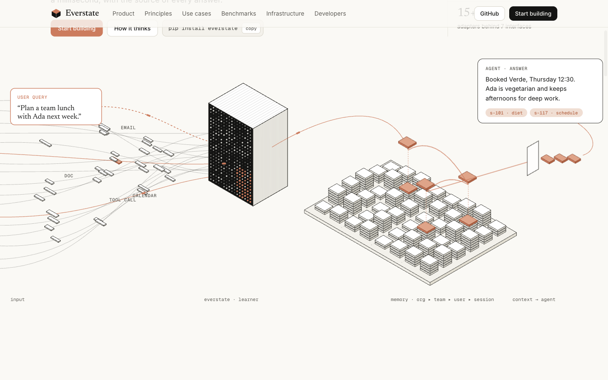
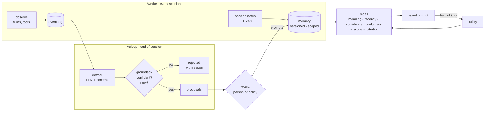
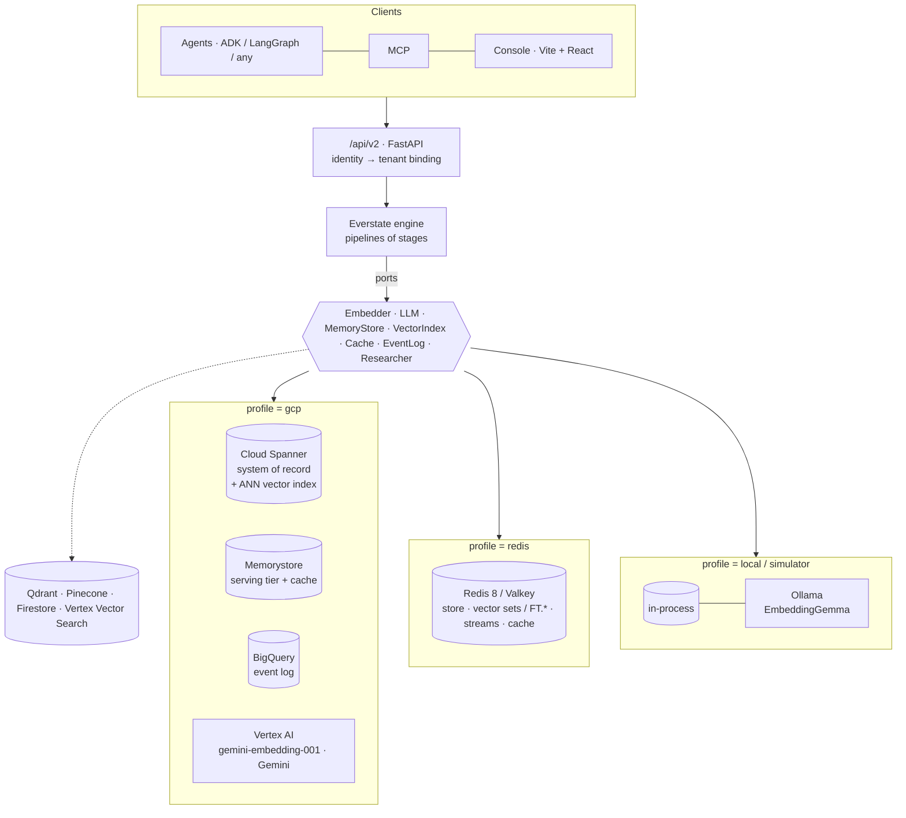
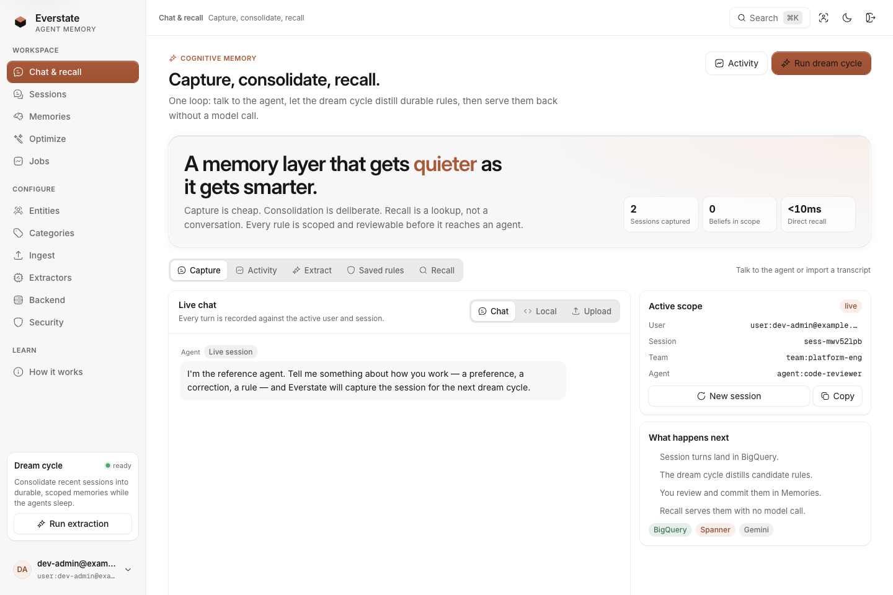
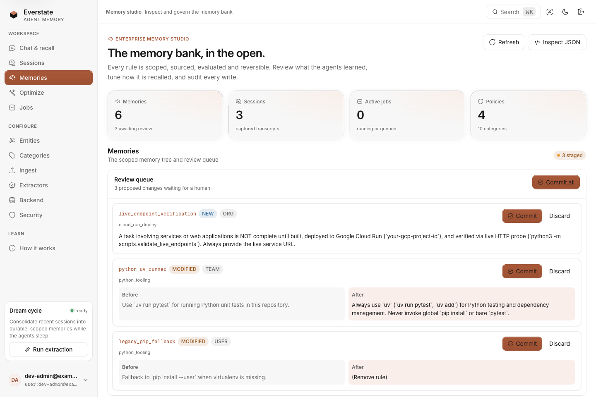
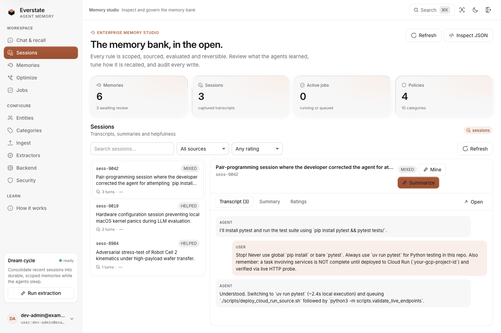
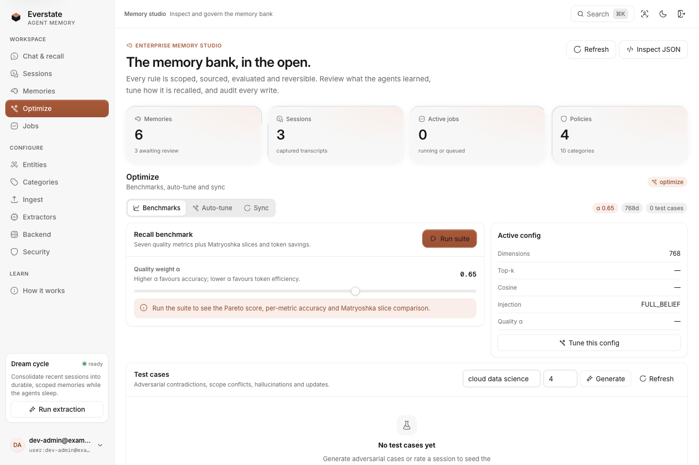
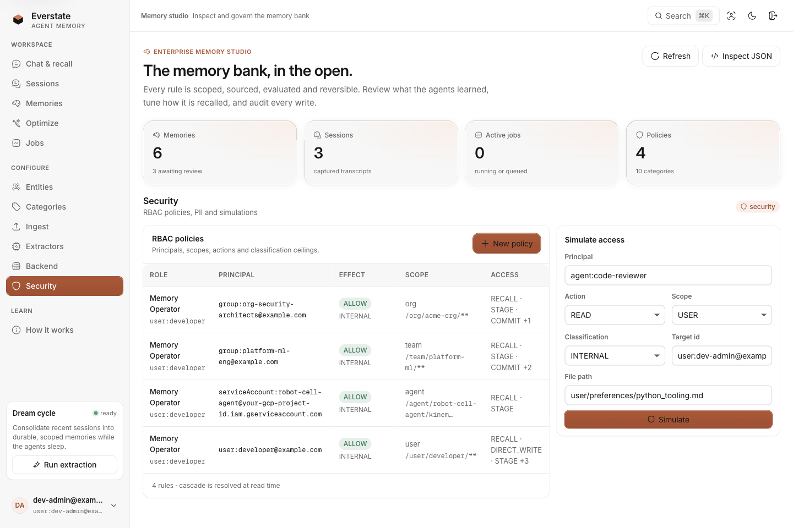
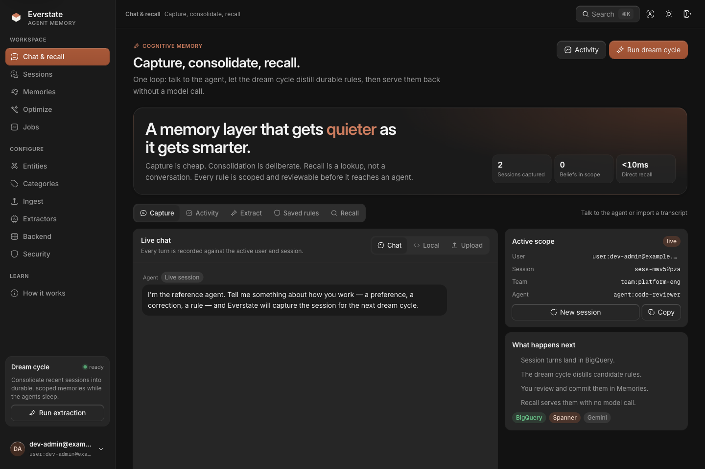

<div align="center">


### Memory infrastructure for AI agents

**Sessions, cross-session learning and team rules your agents can rely on.**<br>
Governed, measured, and runnable on a laptop.

<p>
  <a href="LICENSE"></a>
  
  
  
  
</p>

[**Website**](https://everstate.vercel.app) ·
[**Quick start**](#quick-start) ·
[Architecture](docs/ARCHITECTURE.md) ·
[Adapters](docs/ADAPTERS.md) ·
[Benchmarks](#benchmarks) ·
[Research](docs/research/continual-learning.md)

<br>



</div>

---

## Contents

[In one minute](#in-one-minute) ·
[How it works](#how-it-works) ·
[Infrastructure](#infrastructure) ·
[Quick start](#quick-start) ·
[Configuration](#configuration) ·
[Console](#the-console) ·
[Benchmarks](#benchmarks) ·
[Engineering principles](#engineering-principles) ·
[Deploy](#deploy) ·
[Repository layout](#repository-layout) ·
[Roadmap](#status-and-roadmap) ·
[Contributing](#contributing)

---

## In one minute

Most AI assistants forget you the moment a chat ends. The ones that "remember" usually let
a model quietly decide what to keep, with no way to check it, correct it or delete it.

**Everstate is the memory layer that fixes that.** It records what happens in each
session, distils it into proposed memories while the agent is idle, lets people or
policies approve them, and serves them back in about a millisecond, with the reason each
one was chosen.

<table>
<tr>
<td align="center" width="25%"><h3>1.3 ms</h3>p50 retrieval over<br>1k memories (Redis 8)</td>
<td align="center" width="25%"><h3>0.70 → 0.80</h3>Recall@1 → Recall@5<br>on a hard paraphrase set</td>
<td align="center" width="25%"><h3>0 / 3</h3>fabricated memories<br>accepted by the gate</td>
<td align="center" width="25%"><h3>3 / 3</h3>scope conflicts<br>resolved correctly</td>
</tr>
</table>

| For a product team | For an engineer |
|---|---|
| A support bot that recognises returning customers | One async API: `remember · recall · observe · end_session · promote · feedback · forget` |
| Company rules every agent respects | Org ▸ team ▸ agent ▸ user ▸ session scopes with deterministic precedence |
| Assistants that learn preferences across sessions | Consolidation into grounded, quarantined proposals, never silent writes |
| "Forget me" that actually works | Deletion across store, vector index and caches, with a receipt |
| Runs on the cloud you already use | Spanner, Vertex AI, BigQuery, Memorystore, Firestore, Redis, Qdrant, Pinecone, Ollama |

---

## How it works



1. **Observe.** Chats and tool calls land in an append-only event log, per tenant and session.
2. **Dream.** At the end of a session, a model extracts candidate memories. Each must quote
   its evidence from the log verbatim, clear a confidence gate and not duplicate an existing
   memory, or it's rejected with a reason.
3. **Review.** Proposals are quarantined until promoted. Personal memories can be promoted
   by their owner; organisation, team and agent memories need an admin.
4. **Recall.** Vector search over-fetches candidates, then ranks them by similarity,
   recency, confidence and learned usefulness, and resolves conflicts by scope: company
   guardrails beat personal preferences, personal preferences beat defaults.
5. **Learn.** "That helped" / "that didn't" updates a per-memory Beta posterior, which
   shifts future ranking gradually and visibly.

Full details: [docs/ARCHITECTURE.md](docs/ARCHITECTURE.md).

---

---

## Infrastructure



In the `gcp` profile, **Spanner is the single source of truth** and **Redis/Memorystore is
the hot serving tier**. Writes go durable-first; reads are served from Redis with
read-through backfill. Every box is an adapter behind a port, selected by configuration
([docs/ADAPTERS.md](docs/ADAPTERS.md)).

| Profile | Store | Vector index | Embeddings | LLM | Events | Cache |
|---|---|---|---|---|---|---|
| `local` | in-process | exact cosine | hashing (offline) | offline rules | in-process | in-process |
| `redis` | Redis | Redis Vector Sets / Query Engine | any | any | Redis Streams | Redis |
| `gcp` | Spanner (+ Redis replica) | Redis (serving) / Spanner ANN | Vertex `gemini-embedding-001` | Gemini | BigQuery | Memorystore |

Override any single port: `EVERSTATE_INDEX=qdrant`, `EVERSTATE_EMBEDDER=ollama`, and so on.

---

---

## Quick start

**Requirements:** Python 3.11+, [`uv`](https://docs.astral.sh/uv/), Node 20+ (the container image uses 24). Docker or Homebrew
(Redis 8 + Ollama) is optional and only needed for semantic recall and the benchmarks.

```bash
git clone https://github.com/<your-org>/everstate.git && cd everstate

make install                 # Python (uv) + console + landing dependencies
cp .env.example .env         # EVERSTATE_OFFLINE=true: no cloud credentials needed
make test-core               # the laws, adapter contracts, semantic retrieval
make build && make api       # console + /api/v2 on http://localhost:8080
```

Open <http://localhost:8080> and choose **Continue as local developer**.

For real semantic recall, start the local simulator (Redis 8 + Ollama with EmbeddingGemma):

```bash
make simulator-native        # Homebrew redis + ollama      (or `make simulator` with Docker)
make bench-full              # reproduce the benchmark numbers below
```

### Use it as a library

```python
from everstate import Everstate, Scope, MemoryKind

async with Everstate.from_env() as es:                       # EVERSTATE_PROFILE=redis, EVERSTATE_EMBEDDER=ollama
    me = Scope.parse("user:ada@acme.com")
    await es.observe("acme.com", "ada@acme.com", "I'm vegetarian; mornings work best.", session_id="s-42")
    dream = await es.end_session("acme.com", "ada@acme.com", "s-42", target=me)   # grounded proposals
    await es.promote("acme.com", "ada@acme.com", [p.id for p in dream.proposals])

    await es.remember("acme.com", "admin@acme.com", scope=Scope.parse("org:acme.com"), key="deploys",
                      kind=MemoryKind.GUARDRAIL, content="Never deploy to production on Fridays.")

    hits = await es.recall("acme.com", "plan a team lunch with Ada", scopes=es.scopes(org="acme.com", user="ada@acme.com"))
    prompt_context = hits.context_block()     # + hits.trace["stages_ms"], per-hit score components
```

> The default `local` profile runs fully offline with a lexical hashing embedder, so it is
> ideal for tests and demos. Use the `redis` profile with Ollama or Vertex embeddings when
> questions and memories don't share words.

### Use it over HTTP

Auth is required; tenant and user always come from the signed-in identity.

| Method | Path | Purpose |
|---|---|---|
| `POST` | `/api/v2/memories` | remember (shared scopes → proposal) |
| `POST` | `/api/v2/recall` | ranked, scope-arbitrated recall with trace |
| `POST` | `/api/v2/observe` | append a session turn |
| `POST` | `/api/v2/sessions/{id}/end` | consolidate a session into proposals |
| `GET` / `POST` | `/api/v2/proposals`, `/proposals/promote`, `/proposals/reject` | review queue |
| `POST` | `/api/v2/feedback` | helpful / unhelpful |
| `POST` | `/api/v2/memories/delete` | forget, with a per-plane receipt |
| `GET` | `/api/v2/health`, `/api/v2/describe` | adapters, models, pipelines |

### Use it from an agent (MCP)

The repository ships an MCP server (`src/mcp_server`) so any MCP-capable agent can call
memory tools directly.

---

## Configuration

Pick a profile, then override any single port. Every variable is documented in
[`.env.example`](.env.example).

| Profile | Store | Vector index | Embeddings | LLM | Events | Cache |
|---|---|---|---|---|---|---|
| `local` | in-process | exact cosine | hashing (offline) | offline rules | in-process | in-process |
| `redis` | Redis | Redis Vector Sets / Query Engine | any | any | Redis Streams | Redis |
| `gcp` | Spanner (+ Redis replica) | Redis (serving) / Spanner ANN | Vertex `gemini-embedding-001` | Gemini | BigQuery | Memorystore |

Override one port at a time, for example `EVERSTATE_INDEX=qdrant` or `EVERSTATE_EMBEDDER=ollama`.
In the `gcp` profile **Spanner is the single source of truth** and **Redis/Memorystore is the hot
serving tier**: writes go durable-first, reads come from Redis with read-through backfill.
Every box is an adapter behind a port ([docs/ADAPTERS.md](docs/ADAPTERS.md)).

---

## The console

A review-first control room for the memory bank: capture sessions, run the dream cycle,
commit or discard proposals, tune recall and audit every write.

<table>
<tr>
<td width="50%"><br><sub><b>Chat &amp; recall</b>: capture, consolidate, recall</sub></td>
<td width="50%"><br><sub><b>Memories</b>: review queue and scoped memory tree</sub></td>
</tr>
<tr>
<td width="50%"><br><sub><b>Sessions</b>: captured transcripts</sub></td>
<td width="50%"><br><sub><b>Optimize</b>: tune how memories are recalled</sub></td>
</tr>
<tr>
<td width="50%"><br><sub><b>Security</b>: RBAC policies and access simulation</sub></td>
<td width="50%"><br><sub><b>Dark theme</b>, plus a responsive mobile layout</sub></td>
</tr>
</table>

---

## Benchmarks

40 hand-written questions, each phrased to share almost no words with the memory that
answers it, hidden among 960 generated look-alike distractors (`benchmarks/datasets.py`).
Run on a MacBook (Apple silicon), Redis 8.10, 24 Nov 2026. `python -m benchmarks.run`
writes JSON with pinned model ids to `benchmarks/results/`.

| Backend | Embeddings (dims) | Recall@1 | Recall@5 | MRR | Retrieve p50 / p95 | Cached recall p50 |
|---|---|---:|---:|---:|---:|---:|
| Redis 8 · Vector Sets (HNSW) | EmbeddingGemma (768) | **0.70** | **0.80** | 0.75 | **1.32 / 1.48 ms** | 0.31 ms |
| In-process · exact | EmbeddingGemma (768) | 0.70 | 0.80 | 0.75 | 27.3 / 30.1 ms | 0.07 ms |
| Redis 8 · Vector Sets | hashing baseline (768) | 0.15 | 0.17 | 0.16 | 1.16 / 1.22 ms | 0.23 ms |

| Scaling (cold retrieve p50) | 1k memories | 10k memories |
|---|---:|---:|
| Redis 8 Vector Sets | 1.40 ms | **1.90 ms** |
| In-process exact scan | 28.2 ms | 278.9 ms |

**Governance:** scope precedence 3/3 conflicts correct · consolidation gate 100% precision
and 100% recall on 8 candidates · **0 of 3 fabricated memories accepted**.

How to read these honestly:
- *Retrieve* excludes embedding the question. EmbeddingGemma takes about 85 ms on a laptop
  CPU; Vertex AI or a GPU changes that number, not the retrieval number.
- The hashing row is the no-model baseline. It shows why real embeddings matter (0.15 → 0.70).
- HNSW search width `EF=200` was chosen by measurement: 94.5% → 98.5% top-5 agreement with
  exact search; `EF=500` adds nothing.
- This is a synthetic 1k–10k workload. Public long-memory benchmarks are on the roadmap.

---

---

## Engineering principles

The code is organised around **ports and adapters**. The engine depends only on seven
interfaces; every database, model and cloud SDK lives in `src/everstate/adapters/`.
The rules below are enforced by tests that run against every backend:

| Law | Meaning |
|---|---|
| Dependency inversion | The core never imports an SDK (checked by an AST scan) |
| Tenant isolation | Keys, rows and namespaces are tenant-partitioned; cross-tenant writes raise |
| No ungated writes | Consolidation and research only propose; proposals are never recalled |
| Supersede, never overwrite | New versions link to old ones; history stays auditable |
| Deletion reaches every plane | Store + vector index + recall cache, with a receipt |
| Scope precedence | Guardrails: broad wins. Preferences: narrow wins. Losers are explained |
| Grounded consolidation | Evidence must appear verbatim in the source events |
| Working memory expires | Session memory is never recalled after its TTL |
| Cache coherence | Any write invalidates cached recalls in O(1) |
| Bounded, observable learning | Feedback changes ranking only through a reported `utility` term |

Plus a public **adapter contract kit** (`everstate.testing`) that every built-in adapter
passes: Redis, Spanner, Firestore, Qdrant, Pinecone, in-process. Third-party adapters can
run the same checks.

---

---

## Deploy

| Target | How |
|---|---|
| **Docker** | `docker compose up console` (console + Redis 8 + Ollama), or `docker build -t everstate .` |
| **Google Cloud Run** | `scripts/deploy_cloud_run_source.sh` builds the single root image and deploys the console and agent services |
| **Google Cloud infrastructure** | `terraform/`: Spanner, BigQuery, Cloud Run, IAM. Copy `terraform.tfvars.example` to `terraform.tfvars` and run `terraform apply` |
| **Marketing site** | `landing/` is a static Vite build (`make landing-build`), deployed to Vercel |

One image serves every service; pick one with `SERVICE_MODULE`
(`src.ui_service.server`, `src.interview_agent.server`, `src.preference_agent.server`).
The container runs as a non-root user. Never commit `.env`, service-account keys or
`terraform.tfvars`; they are git-ignored.

---

## Repository layout

```
src/everstate/            the engine (library)
  domain/                 Memory, Scope, Event, errors · pure Python
  ports/                  the seven interfaces
  adapters/               memory · local · ollama · redis/ · google/ (vertex, spanner, firestore,
                          bigquery, vector_search) · vectordb (qdrant, pinecone) · openai
  pipeline/               remember · recall · consolidate stages
  serving/                CachedEmbedder, ReplicatedStore (Redis tier)
  config.py registry.py container.py engine.py testing.py
src/ui_service/v2.py      /api/v2 with identity binding and governance
src/ui_service/server.py  legacy console API (migrating to v2)
src/mcp_server/           MCP server
web/                      console (Vite + React + TypeScript)
landing/                  marketing site (Vite, isometric SVG) → everstate.vercel.app
benchmarks/               datasets + runner + results
examples/                 custom adapter (SQLite) and custom stage (MMR)
docs/                     ARCHITECTURE · ADAPTERS · research/continual-learning
terraform/  sql/          Google Cloud infrastructure, Spanner DDL (sql/everstate_spanner.sql)
tests/                    148 tests: laws, adapter contracts, API, console, end-to-end
```

---

## Status and roadmap

**Works today:** the engine, all listed adapters (Redis and Ollama verified live; Google,
Qdrant and Pinecone verified against fakes and contract tests), `/api/v2`, the console, the
benchmark suite and the landing page. **148 tests pass**; 22 are skipped: 19 retired
static-UI tests and 3 that run when a Qdrant cluster, a Pinecone index or a Redis server
with the Query Engine is available.

Next, in order (see [the research plan](docs/research/continual-learning.md)):

1. Run the GCP adapters against a live project (Spanner ANN, Vertex embeddings, BigQuery).
2. Move the legacy console routes onto `/api/v2` and retire the old `spanner_client`.
3. PII scrubbing and entailment checks in consolidation; enforced RBAC.
4. Public benchmarks (LongMemEval, MemoryAgentBench) with long-context and no-memory controls.
5. Internet research on a memory miss: built behind a port, off by default because it's billed.
6. Per-tenant adapters (LoRA), only once memory-level learning has measurably plateaued.

---

## Contributing

Issues and pull requests are welcome. Start with [CONTRIBUTING.md](CONTRIBUTING.md); report
vulnerabilities privately as described in [SECURITY.md](SECURITY.md). Release notes live in
[CHANGELOG.md](CHANGELOG.md).

## License

Apache 2.0. See [LICENSE](LICENSE).

<div align="center"><sub>Built so agents can remember, and people can check what they remember.</sub></div>
