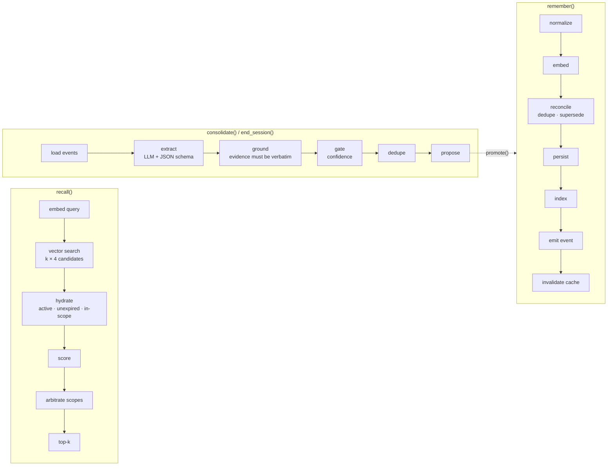

# Everstate architecture

## 1. The laws

These are invariants, not guidelines. Each one has a test in
[`tests/everstate/test_laws.py`](../tests/everstate/test_laws.py) or
[`test_architecture.py`](../tests/everstate/test_architecture.py) that runs against every
available backend.

| # | Law | Enforced by |
|---|---|---|
| L0 | **Dependency inversion.** Only `adapters/` may import an SDK or network client | AST scan of the package |
| L1 | **Tenant isolation.** No read, write or delete crosses a tenant boundary | tenant-partitioned keys, rows and namespaces; `TenantViolation` on writes |
| L2 | **No ungated writes.** Consolidation and research only *propose*; proposals are never recalled | `MemoryStatus.PROPOSED` is excluded from the index and from hydration |
| L3 | **Supersede, never overwrite.** A new version links to the old one, which stays for audit | the `reconcile` stage |
| L4 | **Deletion reaches every plane.** Store, vector index and recall cache | `forget()` returns a per-plane receipt |
| L5 | **Scope precedence.** Guardrails: broad scope wins. Everything else: narrow scope wins. Losers are explained | the `arbitrate` stage |
| L6 | **Grounded consolidation.** A candidate memory must quote evidence that appears verbatim in the source events | the `ground` stage |
| L7 | **Working memory expires.** Session memory is never recalled after its TTL | `expires_at` filtered in store, index and serving tiers |
| L8 | **Cache coherence.** Any write invalidates the tenant's cached recalls | per-tenant generation counter in the cache key |
| L9 | **Learning is bounded and observable.** Feedback moves ranking only through the `utility` score term, reported per hit | Beta-posterior utility in `score` |
| L10 | **Research proposes, never asserts.** External findings arrive as sourced proposals | `research()` writes `PROPOSED` with `source_url` |
| — | **Determinism.** No salted hashing, pinned models, reproducible benchmarks | stable BLAKE2b hashing; model ids recorded in every result |
| — | **Single source of truth.** The durable store is authoritative; Redis is a replica | `ReplicatedStore` writes durable-first, lists from the primary |

## 2. Memory and session model

```
tenant (organisation)                              ← hard isolation boundary
 └─ scopes   org:<tenant> ▸ team:<id> ▸ agent:<id> ▸ user:<email> ▸ session:<id>
      └─ memories  {key, kind, content, confidence, status, version, provenance, embedding, expires_at}
```

- **Kinds:** `fact`, `preference`, `guardrail` (must / must-not), `procedure`, `episode`.
- **Status lifecycle:** `proposed → active → superseded`, or `proposed → rejected`. Only
  `active` is ever recalled.
- **Key** is the canonical slot (`favorite_language`). Arbitration and supersession group
  on it.
- **Sessions:** every conversation carries a `session_id`.
  - Raw turns go to the **event log** through `observe()`.
  - Explicit short-term notes go to `scope=session:<id>` with a TTL (default 24 h), which
    each backend enforces natively: Redis `PEXPIREAT`, Spanner row deletion policy, and an
    index-side filter.
  - `recall(..., scopes=[…, session:<id>])` includes them automatically.
- **Cross-session:** `end_session()` runs the consolidation pipeline over that session's
  events and files **proposals** for the user's scope. Once promoted, they're recalled in
  every future session.
- **Identity binding** (`/api/v2`): tenant = the email domain of the authenticated
  caller, actor = their email, user scope = `user:<email>`. The request body can never
  choose them. Writes to shared scopes (org/team/agent) become proposals and need an admin
  (`EVERSTATE_ADMINS`) to promote.

## 3. The pipelines



**Scoring**

```
score = w_s · cos(q, m) + w_r · 2^(−age / half_life) + w_c · confidence + w_u · (E[utility] − ½)
E[utility] = (1 + helpful) / (2 + helpful + unhelpful)        # Beta(1,1) prior: neutral = 0
defaults: w_s 0.75 · w_r 0.15 · w_c 0.10 · w_u 0.20 · half_life 30 days · min cosine 0.10
```

Every hit returns its components, and every recall returns per-stage timings
(`trace.stages_ms`). Debugging relevance means reading numbers, not guessing.

## 4. Reliability

| Concern | Mechanism |
|---|---|
| Durability | The durable store is written before the Redis replica. A replica miss backfills from the primary. `reindex()` rebuilds a cold serving tier |
| Idempotency | Identical writes return the existing memory. Promotion re-enters the write path with the same ids |
| Cache correctness | O(1) invalidation by generation bump. Cached embeddings are keyed by model, dims, task and SHA-256 of the text |
| Approximate search error | HNSW `EF` 200 measured at 98.5% top-5 agreement with exact search. Candidates are over-fetched 4× before re-scoring |
| Cloud SDK blocking | Every sync SDK call runs in a worker thread (`run_sync`), so the event loop never stalls |
| Failure clarity | Typed errors (`AdapterUnavailable`, `ConfigurationError`, `TenantViolation`, `DimensionMismatch`, `LLMError`) |
| Offline operation | `EVERSTATE_OFFLINE=true` + profile `local` runs everything without credentials, including the full test suite |

## 5. Self-learning, governed

Learning happens at three levels, and the product is explicit about which one is in play:

| Level | What changes | Today |
|---|---|---|
| L1 external memory | rows: facts, preferences, rules | **yes:** consolidation → proposals → promotion; supersession; decay through recency |
| L2 agent-level | ranking weights, utility from feedback, pipelines | **yes:** utility posterior per memory; pluggable stages (MMR, rerankers) |
| L3 parametric | model weights / adapters | **no:** deliberately deferred until L1/L2 headroom is measured (see [research](research/continual-learning.md)) |

## 6. Known gaps (honest list)

- The legacy console API (≈120 routes in `src/ui_service/server.py`) still runs on the
  old `spanner_client` with hashed embeddings. `/api/v2` is the new engine; migration
  happens route by route.
- RBAC beyond "admin can promote shared scopes" is not enforced yet.
- No PII scrubbing stage yet. The pipeline has a natural slot (`normalize`).
- Consolidation's grounding is lexical (verbatim evidence). Entailment checking is next.
- Live GCP paths (Spanner ANN, Vertex embeddings, BigQuery, Vector Search, Firestore)
  are verified with contract tests and fakes, not yet against a live project. Set
  `RUN_GCP_LIVE_TESTS=1` with credentials to run them.
- Benchmarks are a 1k–10k synthetic workload on one laptop. Public long-memory
  benchmarks (LongMemEval, MemoryAgentBench) are the next step.
